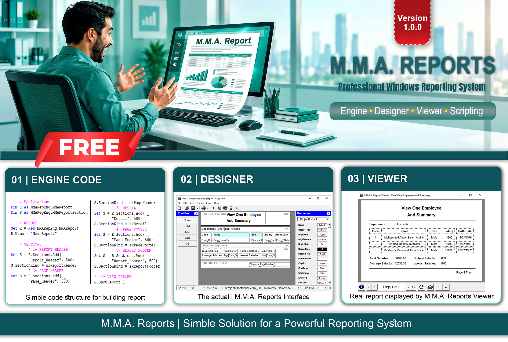
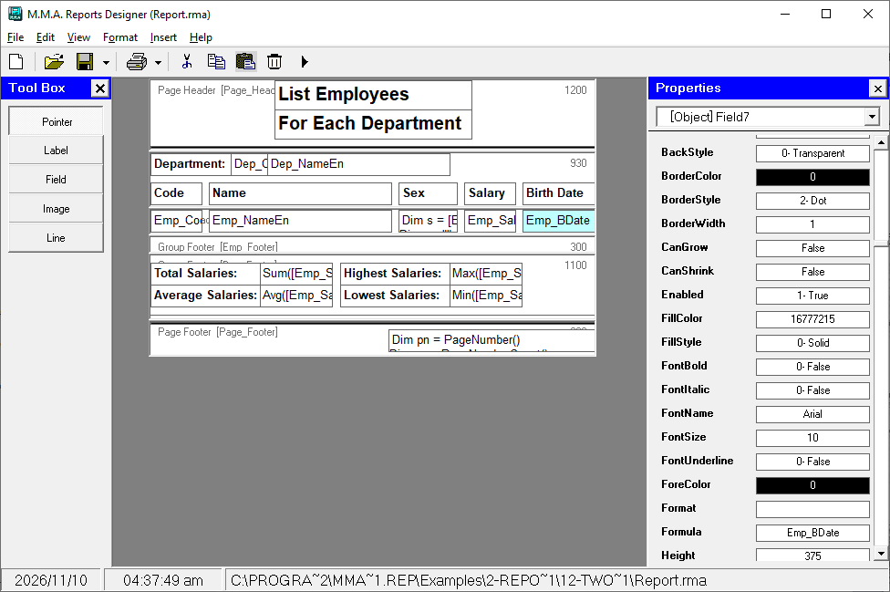
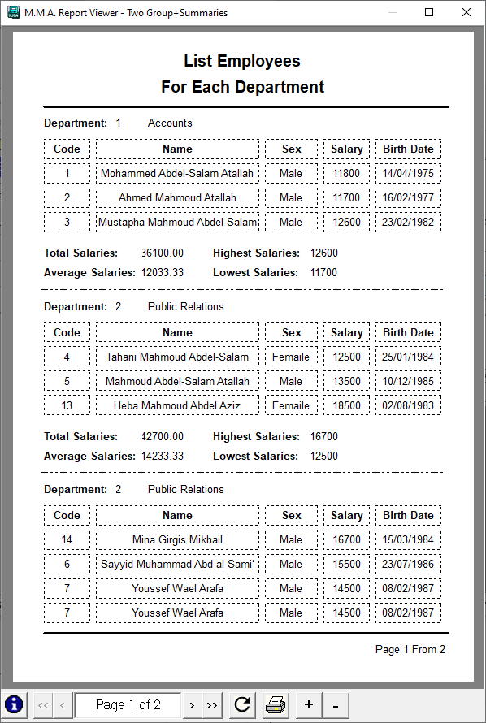
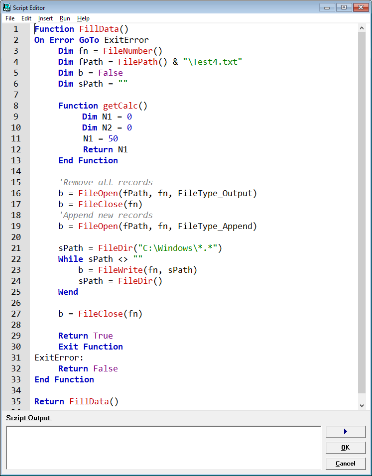
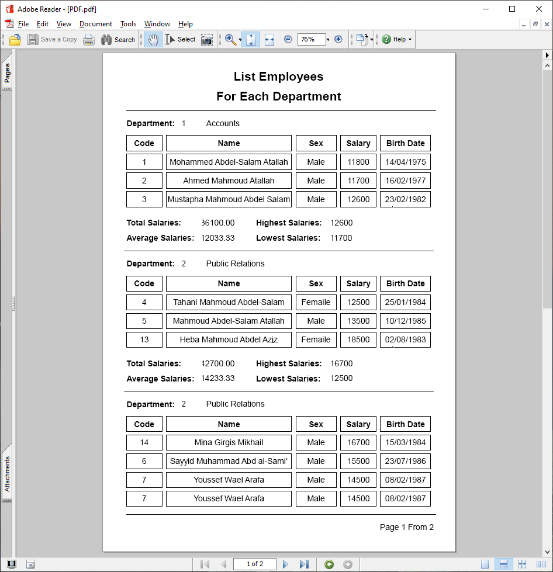
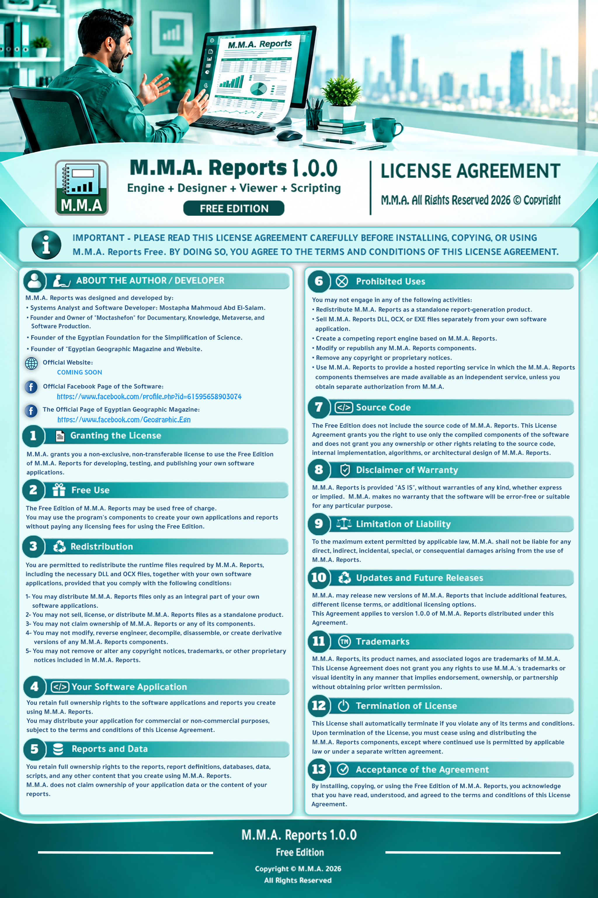

  

    <a href="#about">About</a> •
    <a href="#key-features">Key Features</a> •
    <a href="#the-mma-reports-architecture">Architecture</a> •
    <a href="#screenshots">Screenshots</a> •
    <a href="#developed-for-software-developers">Developers</a> •
    <a href="#free-edition">Free Edition</a> •
    <a href="#about-the-author--developer">Author</a> •
     
    <a href="#product-information">Product Info</a> •
    <a href="#official-links--contact">Contact</a> •
    <a href="#license--intellectual-property">License</a>
  

   
  

    <a href="https://www.facebook.com/profile.php?id=61595658903074" target="_blank" rel="noopener noreferrer">Official Facebook Page</a> •
    <a href="https://www.facebook.com/Geographic.Egn" target="_blank" rel="noopener noreferrer">Egyptian Geographic</a>
  

 

# M.M.A. Reports

### Professional Windows Reporting System

**Engine • Designer • Viewer • Script Editor**

**Version 1.0.0 | Free Edition**

 

---

## About

**M.M.A. Reports** is an integrated Windows-based reporting system designed and developed to provide software developers with a complete environment for creating, processing, executing, and displaying reports within their own software applications.

The system brings together the essential tools and components required throughout the reporting process, from report design and organization to data processing, execution, and final presentation.

Rather than being limited to displaying pre-generated documents, M.M.A. Reports provides developers with a dedicated reporting infrastructure that can be integrated into their software projects to deliver reporting capabilities as part of their own applications.

## Key Features

M.M.A. Reports combines four integrated components, providing developers with a complete environment for report design, data processing, execution, and presentation.

### ⚙️ Engine – Report Processing Engine

The core engine responsible for processing report data, performing calculations, and preparing reports for presentation and printing.

- Supports database and data-file sources.
- Accepts an external ADO Recordset or executes a SQL Query using a Connection String.
- Provides data grouping and aggregation functions:
  `Sum`, `Average`, `Maximum`, `Minimum`, `Count`, `First`, and `Last`.
- Supports mathematical formulas and expressions.
- Handles report formatting and print preparation.

### 🎨 Designer – Visual Report Designer

A visual environment for creating, organizing, and customizing professional report layouts.

- Intuitive Drag & Drop report design.
- Supports four main report elements: `Field`, `Label`, `Image`, and `Line`.
- Controls the position and size of individual objects or multiple selected objects.
- Provides seven standard report sections:
  `Report Header`, `Page Header`, `Group Header`, `Detail`, `Group Footer`, `Page Footer`, and `Report Footer`.
- Supports nested report groups.
- Allows saving, reopening, and editing report designs.

### 📄 Viewer – Report Viewer

A dedicated environment for displaying, reviewing, printing, and exporting generated reports.

- Displays reports page by page.
- Provides page navigation and zoom controls.
- Supports previewing reports before printing.
- Allows direct printing.
- Supports exporting reports to multiple formats, including `PDF`, `XML`, `XLS`, and others.

### 💻 Script Editor – Scripting Environment

A built-in scripting environment that provides programming capabilities for report formulas and expressions.

- Supports variables, constants, and arrays.
- Provides mathematical and logical operations.
- Supports conditional statements: `If / Else` and `Select Case`.
- Supports `For` and `While` loops.
- Allows defining and calling user-defined functions within Formula scripts.
- Provides file and folder operations.
- Supports accessing and processing Recordset data.
- Enables Formula expressions to calculate and return field values.

## The M.M.A. Reports Architecture

M.M.A. Reports consists of four principal components, each responsible for a specific part of the reporting workflow.

### 1. Engine

The core execution component of the system. It is responsible for processing report definitions and handling the execution of reporting operations.

### 2. Designer

The design environment used to create and organize report layouts and their visual structure.

### 3. Viewer

The report presentation component, providing the environment required to display generated reports.

### 4. Scripting

The scripting environment, which provides additional programming capabilities for handling report-related operations and extending the system's functionality.

Together, these components establish an integrated architecture for report design, processing, execution, and presentation.

## Screenshots

Explore the main interfaces and capabilities of M.M.A. Reports through the following screenshots.

### 1. Designer Interface

The report design environment, where developers can create and organize report layouts.

  

### 2. Report Preview

Preview generated reports before printing or final presentation.

  

### 3. Script Editor

The scripting environment for writing and managing report-related scripts and expressions.

  

### 4. Report Output

An example of a report generated using M.M.A. Reports.

  

## Developed for Software Developers

M.M.A. Reports is intended for developers who need to incorporate reporting capabilities into their own Windows applications.

It provides an integrated set of reporting components that developers can use when building their software, allowing them to focus on their application's functionality while relying on M.M.A. Reports for its reporting requirements.

The system is suitable for developing, testing, and publishing both commercial and non-commercial software applications.

## Free Edition

M.M.A. Reports 1.0.0 is distributed as a **Free Edition**, allowing developers to use its components without licensing fees.

Developers are permitted to:

- Use M.M.A. Reports in developing their own software applications.
- Design and create reports for their applications.
- Use the reporting components as part of their software projects.
- Publish and distribute their applications for commercial or non-commercial purposes.
- Redistribute the required M.M.A. Reports runtime files, including DLL and OCX components, as an integral part of their own applications.

The applications, reports, report definitions, datasets, data, scripts, and other content created by developers remain their own property.

Redistribution and use of M.M.A. Reports components are subject to the applicable Free Edition License Agreement.

## About the Author / Developer

M.M.A. Reports was designed and developed by:

**Mostapha Mahmoud Abd El-Salam**  
*Systems Analyst and Software Developer.*

He is also the founder and owner of:

- **Moktashefun:** An initiative specializing in Documentary, Knowledge, Metaverse, and Software Production.
- **Egyptian Foundation for the Simplification of Science:** Founder.
- **Egyptian Geographic Magazine:** Founder of the magazine and its website.

## Product Information

| Property | Details |
|---|---|
| Product Name | M.M.A. Reports |
| Version | 1.0.0 |
| Edition | Free Edition |
| Platform | Windows |
| Architecture | Engine • Designer • Viewer • Scripting |
| Developer | Mostapha Mahmoud Abd El-Salam |
| Company | M.M.A. Software Company |
| Location | Cairo, Egypt |
| Copyright | © 2026 M.M.A. All Rights Reserved. |

## Official Links & Contact

- **M.M.A. Reports – Official Facebook Page:**  
  https://www.facebook.com/profile.php?id=61595658903074
- **Egyptian Geographic Magazine – Official Facebook Page:**  
  https://www.facebook.com/Geographic.Egn
- **Official Website:** Coming Soon.
- **Email:** MMASoftwareCompany@gmail.com
- **Mobile:** +20 109 857 0165

## License & Intellectual Property

M.M.A. Reports is privately owned, proprietary software developed and published as an independent software product.

The Free Edition is distributed without source code and is governed by the **M.M.A. Reports Free Edition License Agreement**.

All intellectual property rights associated with M.M.A. Reports, including its software components, source code, internal implementation, algorithms, architectural design, product names, trademarks, and associated logos, are reserved exclusively by the respective rights holder.

M.M.A. Reports and its associated intellectual property are protected under applicable intellectual property laws. Official registration and deposit details, where applicable, shall be supported by their corresponding legal records.

The distribution of the Free Edition does not constitute a transfer of ownership or intellectual property rights to its users. All rights not expressly granted under the License Agreement remain reserved.

**Copyright © 2026 M.M.A. All Rights Reserved.**

### License Agreement

The following document presents the M.M.A. Reports Free Edition License Agreement in both Arabic and English.

